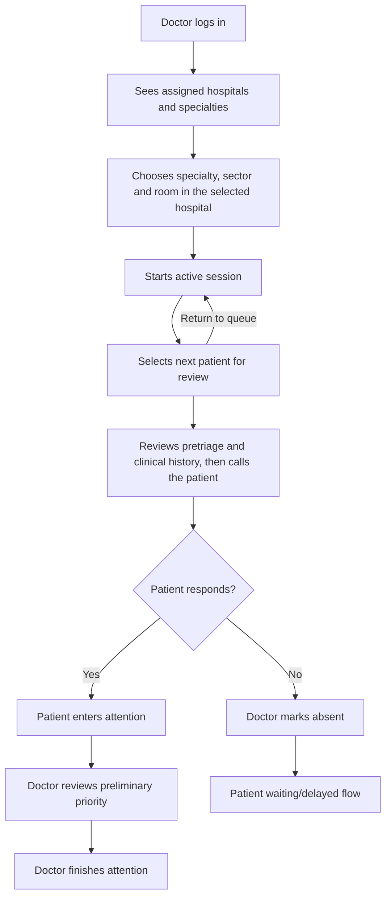

# Doctor Flow

## Main Flow

## Session Rules

- A doctor is already assigned to hospitals and specialties by the admin domain.
- A doctor starts a session by choosing hospital, specialty, sector, and room.
- A doctor cannot change specialty inside a session.
- To change specialty, close the current session and start another.
- A session belongs to exactly one sector; the room must belong to that sector and
  the sector to the same hospital+specialty, or the startup is rejected.
- A room can be used by one doctor at a time.
- A doctor can have one active or paused session at a time.
- After a reload or new login, the active or paused session and any `EN_REVISION`,
  `LLAMADO`, or `EN_ATENCION` consultation are recovered from the backend.
- A paused session continues reserving the doctor and room, although it does not count as estimation capacity.
- Hospital configuration cannot deactivate that room or sector while the session
  is active or paused. A room must also be active to appear in the doctor selector.
- The doctor must release a reservation or resolve a called or in-progress consultation before
  pausing, closing the session, or selecting another patient.

## Session States

- `ACTIVA`: doctor is attending and counts for estimation.
- `PAUSADA`: doctor is temporarily absent and does not count for estimation.
- `FINALIZADA`: session closed.

## Administrative Session Closure

Hospital administrators can list `ACTIVA` and `PAUSADA` sessions under each
sector in the web configuration panel and explicitly confirm **Finalizar sesión**.
This also works for inactive sectors and legacy sessions whose sector is inferred
from their room. Only an administrator authorized for that hospital can do this.
The list excludes `FINALIZADA`: closing a session removes it from the next list
response. The persisted session remains available for internal historical
references; this administrative endpoint does not provide a finalized-session
history view.

The close operation changes either state to `FINALIZADA` and returns the updated
session. It records the end time and an audit event, and releases the doctor and
room reservation. Pausing does not release
that reservation. Finalization preserves the session and clinical/queue history;
it does not cancel or move queued patients. Repeating a successful close preserves
the original end time and does not add another audit event.

Closure returns `409` while the doctor has a queue entry in `EN_REVISION`, `LLAMADO`, or
`EN_ATENCION`, or the session has an `AtencionMedica.EN_CURSO`. That consultation
must be resolved through the doctor flow first. Administrative closure and doctor
operations acquire the same session row lock, then recheck its state, so a
concurrent patient call cannot continue using a session the administrator closed.

After closure and resolution of all pending consultations, an administrator can
delete a sector with history from configuration. Deletion archives the sector
and its rooms and preserves their historical references.

## Reviewing And Calling Patients

- **Seleccionar siguiente paciente** reserves the first `EntradaCola.EN_COLA` of the session's
  hospital, specialty, and sector by priority descending, relative order ascending, and
  entry time ascending. Both records become `EN_REVISION`, assigned to the doctor and room.
- The reserved patient stops appearing in the available list and queue estimates. The
  patient app shows that the doctor is reviewing the case.
- The doctor reads pretriage symptoms and clinical history in the session screen. **Llamar paciente**
  transitions the selected records to `LLAMADO` and records the call time.
- The same pretriage summary stays visible while the doctor waits for the patient and
  after they confirm the patient's presence.
- **Devolver a la cola** releases the assignment, restores `EN_COLA`, and preserves the previous
  queue priority, relative order, and entry time.

Startup updates the PostgreSQL enum checks created by older versions so both
`entrada_cola.estado` and `consulta_medica.estado_consulta` accept `EN_REVISION`.

If patient appears:

- Entry becomes `EN_ATENCION`.
- Consultation becomes `EN_ATENCION`.
- Doctor, room, and session context are assigned.
- An `AtencionMedica.EN_CURSO` historical record is created and linked to the consultation and session.

If patient does not respond:

- Doctor marks absent manually.
- Entry becomes `EN_ESPERA`.
- `tipoPausa = AUSENTE_AL_LLAMADO`.
- Patient decides whether they are delayed or returning.

## Completing Attention

When attention finishes:

- The doctor must first confirm the preliminary priority or correct it.
- Confirmation is a one-click action. A correction requires a different priority; its short reason is optional.
- Each genuine review change creates an append-only `RevisionPrioridadConsulta` record with doctor, previous and new priority, decision, optional reason, and timestamp.
- Repeating the exact same review is idempotent and does not duplicate history.
- The current effective value is also stored in `ConsultaMedica.nivelDeGravedadMedico` for direct reads. Reviewing it does not reorder an entry that is already `EN_ATENCION`.
- Priority can be changed again while attention remains open, but never after finalization.
- `EntradaCola` and `ConsultaMedica` become `FINALIZADA`.
- The linked `AtencionMedica` becomes `FINALIZADA` and stores its end time.

The authorized clinical summary and review state are available at
`GET /api/medico/sesiones/{sesionId}/consultas/{consultaId}/pretriaje`.
The same response carries `estadoClasificacion`, `cierreParcial` and the literal
`mensajesConversacion`. If classification closed as `PARCIAL` without a valid AI
summary, the web shows the transcript in this consultation view and labels the
queue's initial priority provisional. The doctor still reviews priority through
the existing workflow; no second consultation or queue entry is created.
`PUT /api/medico/sesiones/{sesionId}/consultas/{consultaId}/revision-prioridad`
accepts `CONFIRMAR`, or `CORREGIR` with a required different `prioridad` and an
optional `motivo` of at most 500 characters. Finalization returns `409` while
the review is pending.

During attention, **Marcar declaración falsa** opens a confirmation dialog for
an intentional false declaration. Confirming records one discrepancy for the
assigned doctor and attention. The priority controls remain available. The
hospital administrator can annul the record from **Discrepancias**, and the
patient's access to remote registration is recalculated by DNI.
See [patient flow](02-patient-flow.md#suspensión-de-nuevas-solicitudes-digitales).

## Queue Visibility And History

- `GET /api/medico/asignaciones` returns the doctor's hospital and specialty assignments.
- `GET /api/hospitales/{hospitalId}/sectores?codigoEspecialidad={codigoEspecialidad}` returns the active sectors of a hospital for the given specialty.
- `GET /api/hospitales/{hospitalId}/sectores/{sectorId}/salas?codigoEspecialidad={codigoEspecialidad}` returns the active rooms of a sector for the given specialty.
- Web loads sectors after choosing a specialty, then loads rooms after choosing a
  sector. Changing either parent clears the dependent selections; starting a
  session sends `hospitalId`, `codigoEspecialidad`, `sectorId`, and `salaId`.
- `GET /api/medico/sesiones/actual` returns the authenticated doctor's active or
  paused session and their reserved, called, or in-attention consultation, if present.
- `GET /api/medico/sesiones/{sesionId}/pacientes-disponibles` lists ordered `EN_COLA`
  patients for the session hospital, specialty, and sector with preliminary priority,
  name, document, and consultation state.
- `GET /api/medico/atenciones` returns the authenticated doctor's historical attention records.

## Clinical History Access

The active session's doctor can read patient clinical details and active study
metadata while the assigned consultation is `EN_REVISION`, `LLAMADO`, or
`EN_ATENCION`. The data comes from the patient's profile and existing clinical
history. Both the review and attention screens request it from
`GET /api/medico/sesiones/{sesionId}/consultas/{consultaId}/datos-clinicos`.

Opening a study requests
`GET /api/medico/sesiones/{sesionId}/consultas/{consultaId}/datos-clinicos/estudios/{estudioId}/archivo`.
The doctor can preview PDF, JPEG, PNG, GIF, WebP, and BMP files. Other file types
are available by explicit download. The session verifies its assigned
consultation on every request, and the study must be active and belong to that
patient.
Clinical details load independently from file storage. If an attachment is
unavailable, the doctor can continue reviewing the consultation.

`GET /api/medico/atenciones` lists the authenticated doctor's previous visits
in hospitals where they retain medical access. The following patient-specific
endpoints require at least one recorded visit by that doctor for the patient
in an accessible hospital. An existing hospital membership must be active
and include the medical role. Legacy visits without a membership row
continue to qualify:

- `GET /api/medico/pacientes/{pacienteId}/historial-clinico` retrieves active medical records for the patient.
- `GET /api/medico/pacientes/{pacienteId}/historial-clinico/{estudioId}/archivo` downloads a specific active medical record file.
- `GET /api/medico/pacientes/{pacienteId}/historial-clinico/{estudioId}/reporte` retrieves structured information about a specific medical record.
- `GET /api/medico/pacientes/{pacienteId}/ultimos-reportes?limite=5` gets up to `limite` most recent active medical records ordered by `fechaSubida` DESC (`activo=true`; `limite` defaults to `5`; values `< 1` return `400`) for quick triage reference.
